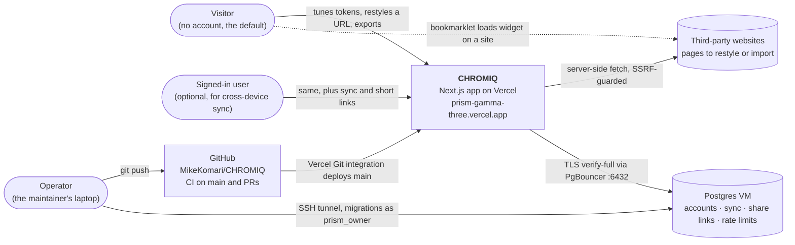
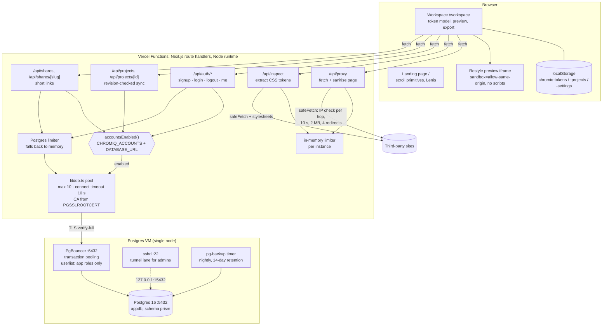
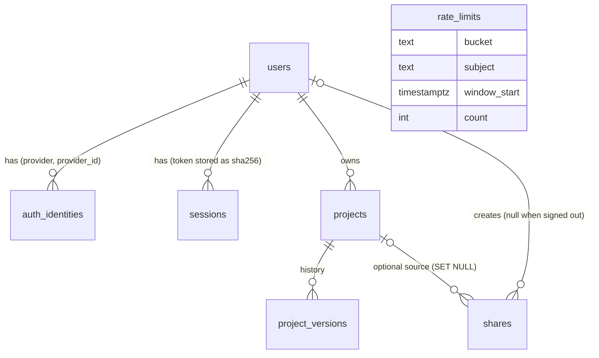

# CHROMIQ architecture

Two levels of zoom. **L0** shows CHROMIQ as one box among the people and systems
it touches. **L1** opens that box into its deployable parts. The diagrams are
Mermaid, so they render on GitHub. Decisions behind the shapes are in
[`adr/`](adr/README.md).

As of 2026-11-05.

## L0: system context

What to notice:

- **The database is optional.** With no `DATABASE_URL`, or with
  `CHROMIQ_ACCOUNTS=off`, CHROMIQ is a fully working local-only tool
  ([ADR-0001](adr/0001-local-first-accounts-opt-in.md),
  [ADR-0010](adr/0010-explicit-accounts-flag.md)). As of 2026-10-30 production
  ran this way: the Vercel project had no environment variables set.
- **CHROMIQ makes outbound requests to arbitrary sites** on a visitor's
  instruction. That is the largest attack surface, and it is why the proxy is
  built the way it is ([ADR-0011](adr/0011-restyle-proxy-script-free-sandbox.md)).
- **Production deploys come from the Vercel Git integration on every push to
  `main`.** The `v*`-tag workflow in `.github/workflows/deploy.yml` has never
  run, so tagging is not how releases happen today.

## L1: containers

### What lives where

| Part | Code | State it owns | Needs the database? |
|---|---|---|---|
| Landing page | `app/page.tsx`, `components/landing/`, `components/scroll/` | none | No |
| Workspace | `components/workspace*`, `hooks/use-workspace.ts`, `lib/tokens.ts`, `lib/exporters.ts` | tokens, projects, snapshots, versions, in `localStorage` | No |
| Restyle proxy | `app/api/proxy/route.ts`, `lib/safe-fetch.ts`, `lib/url-safety.ts`, `lib/sanitize-html.ts` | none | No |
| URL import | `app/api/inspect/route.ts`, `lib/css-extract.ts` | none | No |
| Accounts | `app/api/auth/*`, `lib/server/sessions.ts`, `lib/server/passwords.ts` | `users`, `auth_identities`, `sessions` | Yes |
| Cloud sync | `app/api/projects/*`, `lib/sync.ts`, `hooks/use-account.ts` | `projects`, `project_versions` | Yes |
| Short links | `app/api/shares/*`, `lib/server/shares.ts` | `shares` | Yes; the client falls back to `?share=` |
| Shared rate limit | `lib/server/rate-limit-db.ts` | `rate_limits` | Prefers it; falls back to memory |
| Feature gate | `lib/server/features.ts` | none | Reads `CHROMIQ_ACCOUNTS`, `DATABASE_URL` |
| Bookmarklet | `public/chromiq-widget.js`, `lib/bookmarklet.ts` | none | No |

### Schema (`migrations/1729670000000_init.sql`)

Every foreign key to `users` is `ON DELETE CASCADE`, which is what makes
`DELETE /api/auth/me` a complete account deletion.

### Environments

| | Local dev | Production (Vercel project `prism`) |
|---|---|---|
| URL | `http://localhost:3000` | `https://prism-gamma-three.vercel.app`. Other `*.vercel.app` aliases sit behind Vercel Authentication. |
| Accounts | On when `.env.local` has `DATABASE_URL` | Off. No env vars were set as of 2026-10-30. |
| Database lane | pooled `DATABASE_URL` for the app, tunnel `DIRECT_URL` for migrations | pooled `DATABASE_URL` only |
| CA for TLS | `PGSSLROOTCERT` as a file path | `PGSSLROOTCERT` as PEM text |
| Node | 22 (via nvm; the system Node 18 breaks tests and migrations) | Vercel default |
| CI | — | GitHub Actions on Node 20: lint → typecheck → test → build, on pushes to `main` and on PRs |
